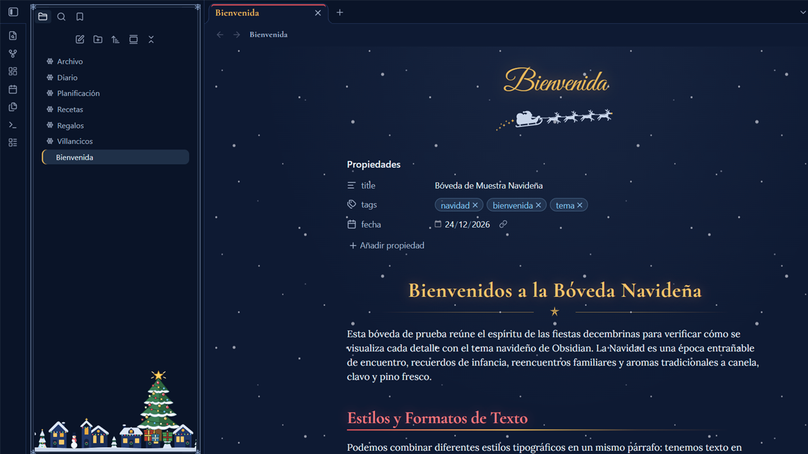
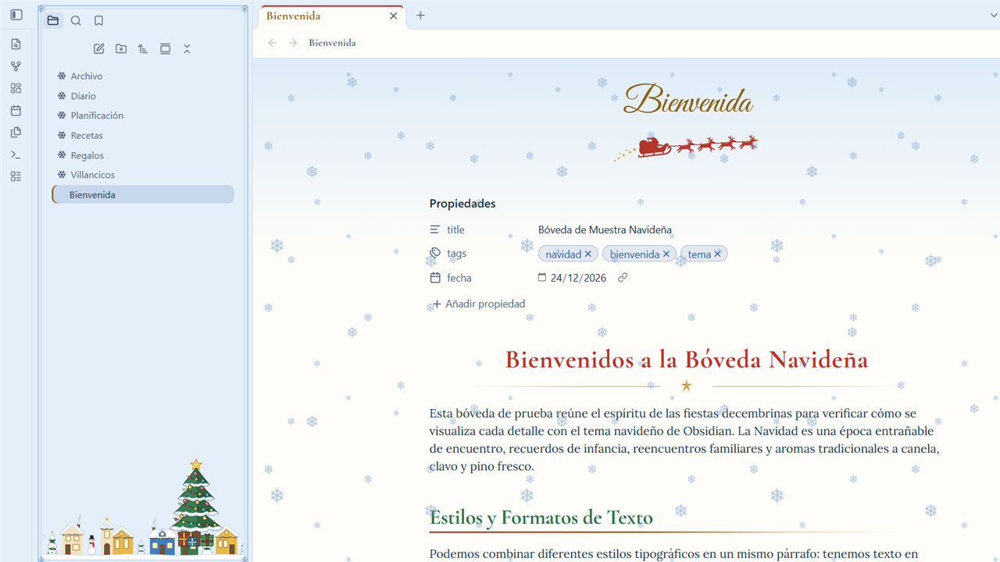
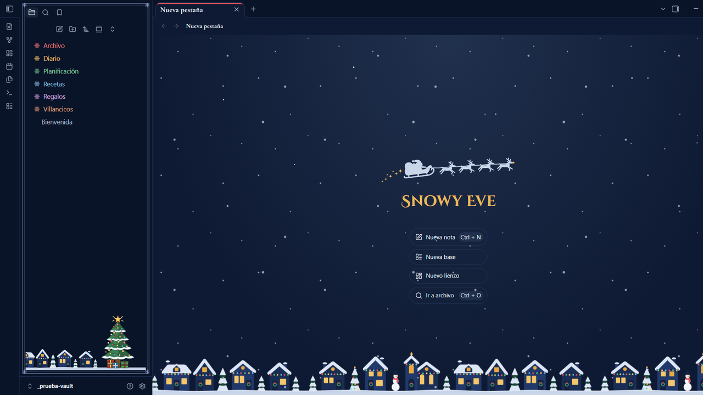
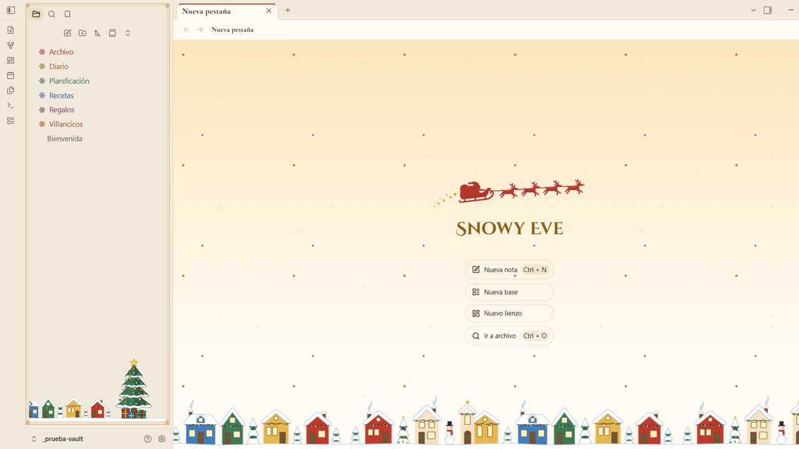
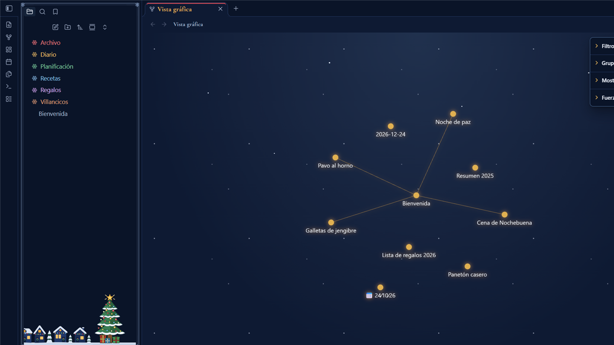
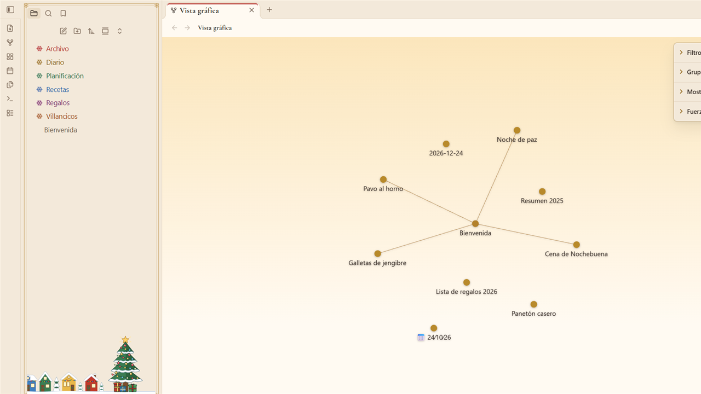

# Snowy Eve ❄️

A cozy Christmas theme for [Obsidian](https://obsidian.md): Christmas Eve by night — a midnight blue sky with faint stars, golden lights and red baubles — and Christmas Day by morning — a warm cabin morning of ivory paper and candle-lit cream, with fairy lights twinkling over coloured houses. Classic serif typography with decorative Christmas-card capitals for the note title, festive headings, Santa's sleigh under every note title, a lit Christmas tree over a decorated village, snowflake folder toggles, gently falling snow by night and twinkling lights by day.





The new tab: Santa's sleigh over the decorated village, with a lit tree in the file explorer — snow by night, twinkling lights by day.





The graph view: Christmas baubles connected by golden garlands over a quiet sky — a warm glow by night, soft shadows by day.





## Features

- **Dark and light modes** — *Christmas Eve* (midnight blue sky with faint stars behind notes, snow-white text, golden lights, red baubles) and *Christmas Day* (a warm cabin morning: ivory paper, candle-lit cream, the golden glow of the village windows, espresso text, red, pine green and gold). Text contrast meets WCAG AA in both, headings included.
- **Typography** — Lora for reading, bold Cormorant Garamond for headings, and the decorative Christmas-card capitals of Cinzel Decorative for the note title (easy to read even in all caps), all embedded (no network requests). Option to use Cormorant Garamond for note titles as well.
- **Festive headings** — each level has its own Christmas colour: gold, coral red, holly green, ice blue, frost silver and copper by night (with a soft glow on H1–H3); red, pine green, gold, house blue, plum and copper by day. H2 carries a red-to-gold ribbon. Bold, italics, highlights and inline code are tinted to match.
- **Ornaments** — Santa and his reindeer sleigh under each note title (or a golden star), a gold rule with a star under H1 and on dividers, red baubles (golden in sublists) as bullets, a bauble on H3, and checked tasks with a golden star over a red bauble.
- **File explorer** — larger names and icons, and each top-level folder gets its own Christmas colour in order (red, gold, green, ice blue, plum, copper), shared by its subfolders. A snowflake replaces the folder arrow (rotates when opened), and a lit Christmas tree with presents stands over a village decorated with strings of lights, wreaths and a snowman (night houses with glowing windows; coloured houses with snowy roofs by day).
- **Falling snow by night, twinkling lights by day** over your notes and the new tab. By day, small gold, red, green and blue fairy lights blink in three groups out of step, like the lights on a tree, and fade to a third behind the text column so they never get in the way of reading. Neither ever catches clicks, and both hide themselves when your system asks to reduce motion.
- **Frost frames** — a thin double line with snowflake corners around sidebar panels and dialogs.
- **New tab** with Santa's sleigh crossing the sky over the decorated village, with falling snow by night and twinkling lights by day.
- **Graph view** — notes become golden Christmas baubles, like the lights on the tree (tags and attachments in coral red and holly green by night, red and pine green by day), hung on golden garland lines, with a soft halo around them (a golden glow by night, a gentle shadow over ivory paper by day). Hovering a node lights it and its connections up (light gold by night, red by day). Behind it there is only a calm sky (a still field of stars by night, the warm morning glow by day), with no village and nothing animated, so the graph stays smooth. In the global and the local graph.
- **Dates in note titles and headings** use lining figures, so the digits of a date like `24∕10∕26` line up.

## Settings

Install the [Style Settings](https://github.com/mgmeyers/obsidian-style-settings) plugin to tweak the theme:

| Option | Default |
|---|---|
| Disable falling snow and twinkling lights | Off |
| Snow and lights intensity | 0.6 |
| Disable the sky behind notes (stars by night, morning glow by day) | Off |
| Disable the decorated village under the file explorer | Off |
| Disable the Christmas tree in the file explorer | Off |
| Single-colour folders (gold snowflakes, no colour per folder) | Off |
| Plain graph background (remove the sky and stars) | Off |
| Graph without glow (flat nodes, lighter on very large graphs) | Off |
| Emblem under the note title | Santa's sleigh |
| Folder toggle in the file explorer | Snowflake |
| Plain list bullets | Off |
| Disable heading and divider ornaments | Off |
| Disable frost frames | Off |
| Serif note title | Off |
| Golden lights | Theme palette |
| Bauble red | Theme palette |
| Ice blue | Theme palette |

The accent color (buttons, selection) follows **Settings → Appearance → Accent color**.

## Installation

- **From Obsidian:** Settings → Appearance → Themes → Manage → search for *Snowy Eve* → Install and use.
- **Manually:** download `manifest.json` and `theme.css` from the
  [latest release](https://github.com/Mack-Yilman/obsidian-snowy-eve/releases/latest) into
  `<your vault>/.obsidian/themes/Snowy Eve/`, then pick the theme in Settings → Appearance.

## Development

`theme.css` is generated: edit `src/theme.src.css` and the SVGs in `src/ornaments/`, then run:

```bash
npm install
node build.mjs          # builds theme.css with the fonts (base64) and the SVG ornaments embedded
npm run lint            # Obsidian's official stylelint rules
node tools/contraste.mjs  # checks the palette contrast
```

## Español

Tema navideño para Obsidian: de noche, la espera de Nochebuena (cielo azul medianoche con estrellas, luces doradas y esferas rojas); de día, la mañana de Navidad en una cabaña cálida (papel marfil, crema a la luz de las velas y casas de colores). Título en mayúsculas de tarjeta navideña (Cinzel Decorative), encabezados con un color navideño por nivel, trineo de Santa bajo el título de cada nota, un árbol iluminado sobre un pueblo adornado con luces, copos de nieve en las carpetas, nieve que cae suavemente de noche y luces que titilan intercaladas de día. Las opciones se configuran con el plugin Style Settings.

## Credits

Made by Mack Chirinos. Font licenses are listed in [THIRD-PARTY-NOTICES.md](THIRD-PARTY-NOTICES.md).

## License

[MIT](LICENSE)
